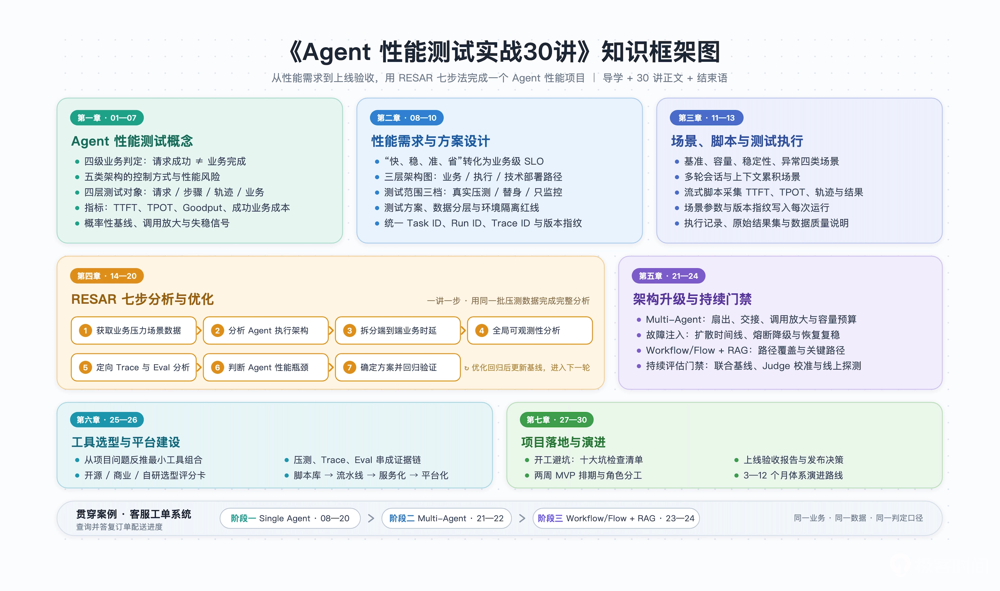
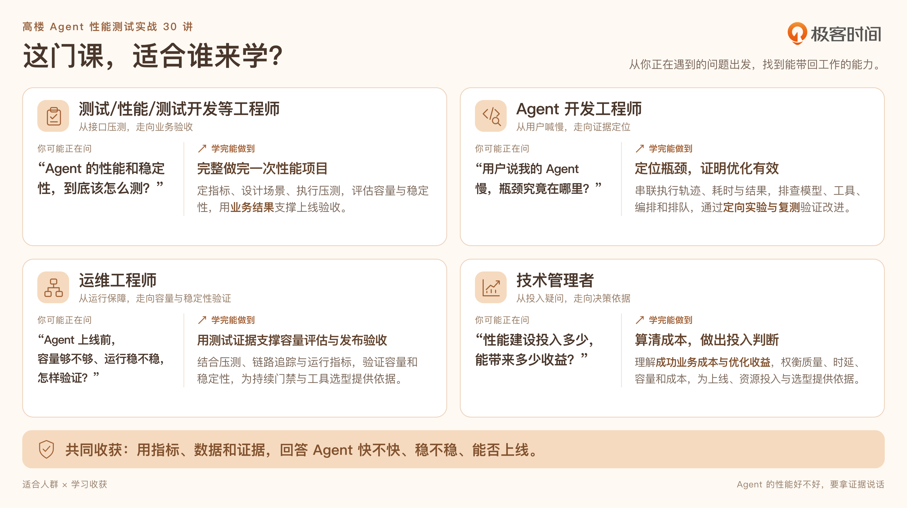

# agent-perf-testing-30-lectures

**Author: 7DGroup**

> 《Agent 性能测试实战30讲》课程配套仓库，课程已上架极客时间：[time.geekbang.org/column/intro/101193401](https://time.geekbang.org/column/intro/101193401?tab=intro)。
> 范围：贯穿案例客服工单系统、测试数据集、k6 压测套件、脚本与可复用模板；配套资产按讲次逐步开放，课程正文请在专栏阅读。

  
  
  
  
  

## 📌 课程信息

| 项目 | 说明 |
|------|------|
| 课程系列 | 《Agent 性能测试实战30讲》：开篇词 + 导学 + 直播回放 + 30 讲正文 + 结束语，共 33 讲，[已上架极客时间](https://time.geekbang.org/column/intro/101193401?tab=intro) |
| 课程讲师 | 高楼 · 盾山科技 CEO，7DGroup 创始人 |
| 更新节奏 | 连载中，每周一 / 三 / 五更新，已更新 5 / 33 讲 + 直播回放（状态详见下方课程篇目） |
| 课程定位 | 面向测试 / 性能 / 测试开发工程师、Agent 开发工程师、运维工程师与技术管理者的项目实战课：从性能需求到上线验收，用 RESAR 七步法完整做完一个 Agent 性能项目 |
| 贯穿案例 | 一个客服工单系统 + 两次架构升级：Single Agent → Multi-Agent → Workflow/Flow + RAG，业务为「查询并答复指定订单的配送进度」 |
| 核心指标 | TTFT、TPOT、Goodput（有效吞吐）、成功业务成本与四级业务判定（请求成功 / 流程完成 / 业务完成 / 结果合格） |
| 仓库用途 | 存放课程配套资产：案例系统、测试数据集、k6 压测套件、脚本与可复用模板，按讲组织 |
| 当前状态 | 已开放导学与第 01—06 讲的配套模板及第 02/03 讲引用的实验数据；项目源码、测试数据与脚本随对应讲次逐步开放 |

## 📖 课程介绍

接口返回 200，Agent 就完成任务了吗？请求成功不等于业务合格。本课程将"快、稳、准、省"转化为可验收指标，带你掌握 TTFT、TPOT、Goodput 及成功业务成本等关键度量，建立区分流程完成与结果合格的性能判断标准；并通过 RESAR 七步分析法，串联压测数据、执行轨迹与评测结果，从端到端时延拆分到定向 Trace 分析，用证据定位模型推理或编排瓶颈。

课程以查询订单配送进度的客服工单 Agent 为主线：同一业务、两次架构升级（Single Agent → Multi-Agent → Workflow/Flow + RAG），从性能需求到上线验收，完整做完一个 Agent 性能项目。配套提供代码、工单样本、订单与物流快照、压测脚本和实验记录，支持跟着项目动手实践。

**你将获得：**

- 工程方法：即学即用的 Agent 性能七步分析法
- 落地指标：把"快、稳、准、省"转化为具体测试目标
- 项目实例：Agent 性能项目全链路打通（含配套代码）
- 科学评测：串联压测数据、执行轨迹与评测结果
- 复用资产：项目计划、场景设计、测试报告等常用模版

  

## 👥 适合谁学

| 人群 | 转变方向 | 学完能做到 |
|---|---|---|
| 测试 / 性能 / 测试开发等工程师 | 从接口压测，走向业务验收 | 完整做完一次性能项目：定指标、设计场景、执行压测，评估容量与稳定性，用业务结果支撑上线验收 |
| Agent 开发工程师 | 从用户喊慢，走向证据定位 | 定位瓶颈，证明优化有效：串联执行轨迹、耗时与结果，排查模型、工具、编排和排队，通过定向实验与复测验证改进 |
| 运维工程师 | 从运行保障，走向容量与稳定性验证 | 用测试证据支撑容量评估与发布验收：结合压测、链路追踪与运行指标，为持续门禁与工具选型提供依据 |
| 技术管理者 | 从投入疑问，走向决策依据 | 算清成本，做出投入判断：理解成功业务成本与优化收益，权衡质量、时延、容量和成本，为上线、资源投入与选型提供依据 |

> 🛡️ 共同收获：用指标、数据和证据，回答 Agent 快不快、稳不稳、能否上线。

  

## 👨‍🏫 讲师介绍

**高楼** · 性能专家，架构级性能解决方案资源专家，盾山科技 CEO，7DGroup 创始人，性能标准撰写人，网名 Zee。

- **20 年以上性能测试分析调优经验**，长期致力于架构级性能测试、容量水位规划、性能瓶颈分析、性能异常等技术方向。
- **工作重心**在 AI Agent 架构设计、AI 大模型与 Agent 应用的非功能工程落地，覆盖 AI 应用的架构设计与选型、性能需求分析与指标定义、性能测试与压测、瓶颈定位与调优、容量规划与稳定性治理、持续评估门禁建设的完整链路。
- 将多年沉淀的 **RESAR 性能分析七步法**升级到 Agent 场景，围绕 TTFT、TPOT、Goodput、成本与质量等指标建立 AI 大模型应用的性能评估体系，能够对多种 AI 主流架构做端到端的性能分析与优化，并带队研发了压测脚本、Trace 分析、Eval 验证等配套工具链。
- 曾带领 **300 人以上的国内外混合团队**，完整交付 **40+ 项目**，多次作为出品人和讲师参与大型技术大会。

## 🎁 购买课程

如需购买《Agent 性能测试实战30讲》（[极客时间课程主页](https://time.geekbang.org/column/intro/101193401?tab=intro)），欢迎扫下方推广二维码下单；下单后请加微信 **wxzuozewei** 并发送你的极客时间 ID，可返现金红包，谢谢支持！

  

## 📚 课程篇目

| 讲次 | 标题 | 章节 | 连载状态 |
|---|---|---|---|
| 开篇词 | [Agent 的性能好不好，要拿证据说话](https://time.geekbang.org/column/article/1027150) | 开篇 | ✅ 已更新 |
| [导学](lectures/00-guide/) | [为什么这门课要带你完整做完一个 Agent 性能项目](https://time.geekbang.org/column/article/1027201) | 导学 | ✅ 已更新 |
| 直播回放 | [一次 AI Agent 的性能实战复盘](https://time.geekbang.org/column/article/1028632) | 直播 | ✅ 已更新 |
| [01](lectures/01-http-200-not-business-done/) | [接口返回 200，为什么 Agent 仍然没有完成任务](https://time.geekbang.org/column/article/1027290) | 第一章 必要知识储备 | ✅ 已更新 |
| [02](lectures/02-architecture-performance-risks/) | [都是调模型，不同架构形态，性能风险为什么完全不同？](https://time.geekbang.org/column/article/1028286) | 第一章 必要知识储备 | ✅ 已更新 |
| [03](lectures/03-test-object-layering/) | [Agent 的测试对象如何确定](https://time.geekbang.org/column/article/1028525) | 第一章 必要知识储备 | ✅ 已更新 |
| [04](lectures/04-metrics-selection/) | TTFT、TPOT、Goodput、质量和成本指标应该怎么选 | 第一章 必要知识储备 | 未更新 |
| [05](lectures/05-baseline-and-fingerprint/) | 同一个 Agent 每次结果都不同，如何建立可信的性能基线 | 第一章 必要知识储备 | 未更新 |
| [06](lectures/06-concurrency-degradation/) | 并发还没有到峰值，为什么 Agent 已经开始退化 | 第一章 必要知识储备 | 未更新 |
| 07 | 服务没有报错，如何发现 Agent 稳定性出了问题 | 第一章 必要知识储备 | 未更新 |
| 08 | 如何把「快稳准省」变成可验收的需求 | 第二章 主项目需求与方案设计 | 未更新 |
| 09 | 如何设计合适的测试范围 | 第二章 主项目需求与方案设计 | 未更新 |
| 10 | 如何准备测试方案、数据和环境 | 第二章 主项目需求与方案设计 | 未更新 |
| 11 | 如何组合基准、容量和稳定性场景 | 第三章 主项目场景、脚本与测试执行 | 未更新 |
| 12 | 可运行的流式压测脚本长什么样 | 第三章 主项目场景、脚本与测试执行 | 未更新 |
| 13 | 测试执行过程中记录什么才能让结果更可信 | 第三章 主项目场景、脚本与测试执行 | 未更新 |
| 14 | 第一步：如何获取并读懂业务压力场景数据 | 第四章 RESAR 七步分析与优化 | 未更新 |
| 15 | 第二步：如何分析 Agent 执行架构并找到高风险路径 | 第四章 RESAR 七步分析与优化 | 未更新 |
| 16 | 第三步：一个任务耗时几十秒，如何拆分端到端任务时间 | 第四章 RESAR 七步分析与优化 | 未更新 |
| 17 | 第四步：监控指标很多，如何通过全局可观测性缩小范围 | 第四章 RESAR 七步分析与优化 | 未更新 |
| 18 | 第五步：用定向 Trace 与 Eval 验证性能假设 | 第四章 RESAR 七步分析与优化 | 未更新 |
| 19 | 第六步：最慢的组件就一定是 Agent 性能瓶颈吗 | 第四章 RESAR 七步分析与优化 | 未更新 |
| 20 | 第七步：如何确定优化方案并完成可信的回归验证 | 第四章 RESAR 七步分析与优化 | 未更新 |
| 21 | 扩展到 Multi-Agent 架构，测试方案哪些必须重做？ | 第五章 架构迁移案例 | 未更新 |
| 22 | 一个 Agent 超时，为什么整个 Multi-Agent 系统都会被拖垮 | 第五章 架构迁移案例 | 未更新 |
| 23 | 从动态 Agent 换成 Workflow/Flow，测试对象怎样变化 | 第五章 架构迁移案例 | 未更新 |
| 24 | 把一次 Workflow/Flow 性能测试变成持续评估门禁 | 第五章 架构迁移案例 | 未更新 |
| 25 | 从项目问题反推出最小工具组合 | 第六章 工具选择与平台建设 | 未更新 |
| 26 | 如何把重要数据串成证据链并完成平台建设 | 第六章 工具选择与平台建设 | 未更新 |
| 27 | 开工前最容易踩的十大坑 | 第七章 项目落地与演进 | 未更新 |
| 28 | 两周完成 1.0 版 Agent 性能测试 MVP | 第七章 项目落地与演进 | 未更新 |
| 29 | 准备上线了，如何完成一次可信的性能与稳定性验收 | 第七章 项目落地与演进 | 未更新 |
| 30 | 运行三个月，如何制定从脚本到门禁和平台的演进路线 | 第七章 项目落地与演进 | 未更新 |
| 结束语 | 工具会变，如何沉淀不会过时的项目能力 | 结语 | 未更新 |

正文不在本仓库发布。配套资产按讲次逐步开放，未发布讲目不提前放置半成品；各讲实际引用的路径以正文为准。

## 📂 配套资料目录

| 讲次 | 目录 | 已开放资产 |
|---|---|---|
| 导学 | [lectures/00-guide](lectures/00-guide/) | 暂无（概念篇） |
| 01 | [lectures/01-http-200-not-business-done](lectures/01-http-200-not-business-done/) | 四级业务判定表、单笔业务复核记录、Goodput 与成功业务成本台账 |
| 02 | [lectures/02-architecture-performance-risks](lectures/02-architecture-performance-risks/) | 架构形态与性能风险速查表、风险假设记录、案例二实验数据（Multi-Agent） |
| 03 | [lectures/03-test-object-layering](lectures/03-test-object-layering/) | 分层测试对象表、时延口径自查表、时间口径记录、案例一实验数据（Single Agent） |
| 04 | [lectures/04-metrics-selection](lectures/04-metrics-selection/) | Agent 性能指标字典、Goodput 口径表、监控面板核对清单 |
| 05 | [lectures/05-baseline-and-fingerprint](lectures/05-baseline-and-fingerprint/) | 可复现实验记录、版本指纹、基线与回归判断记录 |
| 06 | [lectures/06-concurrency-degradation](lectures/06-concurrency-degradation/) | 四层并发定义表、调用放大指标表、负载模型选择表、容量风险判据表、并发换算参数表 |

## 🧭 使用方式

1. 在[极客时间专栏](https://time.geekbang.org/column/intro/101193401?tab=intro)阅读正文，按正文中的配套资料提示找到对应讲次目录。
2. 本仓库只提供可运行或可复用的资产，不重复正文讲解。
3. 各讲资产以该讲目录内的 README 为准。
4. 本仓库资料采用 [CC BY-NC-SA 4.0](https://creativecommons.org/licenses/by-nc-sa/4.0/deed.zh-Hans) 授权：仅限学习交流等非商业用途，禁止商业再分发；转载需署名 7DGroup，并以相同协议共享。

## ⚖️ 版权与授权

本仓库全部内容（文档、模板、代码与数据集）版权归 **7DGroup** 所有，采用 [CC BY-NC-SA 4.0](https://creativecommons.org/licenses/by-nc-sa/4.0/deed.zh-Hans)（署名-非商业性-相同方式共享 4.0 国际）许可协议授权，完整法律文本见 [LICENSE](LICENSE)。

- ✅ 允许：学习、教学与研究等非商业用途的使用、复制与传播
- ❌ 禁止：未经授权的商业使用与再分发
- 🔁 条件：转载须署名 7DGroup 并注明本仓库链接，衍生作品须以相同协议共享
- 📖 课程正文（极客时间专栏文章）不在本授权范围内，版权归极客时间及作者所有

## 📄 相关链接

- [k6 官方文档](https://grafana.com/docs/k6/latest/)
- [grafana/k6 GitHub 仓库](https://github.com/grafana/k6)
- [Langfuse（LLM 观测平台）](https://github.com/langfuse/langfuse)
- [Prometheus 监控系统](https://prometheus.io/)
- 课程《Agent 性能测试实战30讲》：[极客时间课程主页](https://time.geekbang.org/column/intro/101193401?tab=intro)；购买返现方式见上方[🎁 购买课程](#-购买课程)小节

## 📮 关注公众号

微信公众号 **7DGroup**：性能工程实战内容，作者动态与课程配套资料动态。

  

- 📣 微信公众号：**7DGroup**
- 📚 课程配套代码组织：[github.com/xncssj](https://github.com/xncssj)（本仓库所在组织）
- 🏢 主组织：[github.com/7dgroup-ai](https://github.com/7dgroup-ai)
