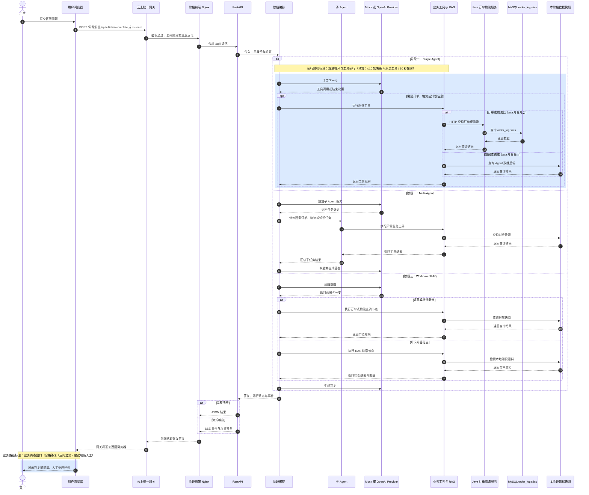
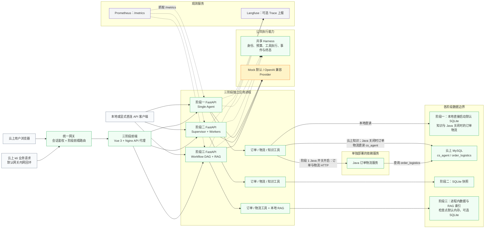
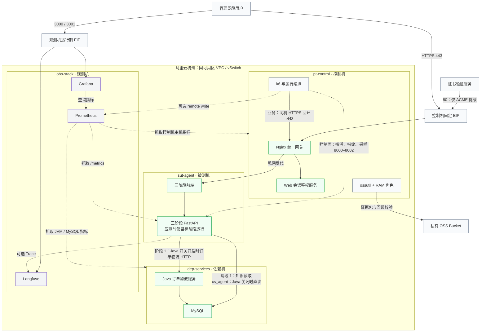
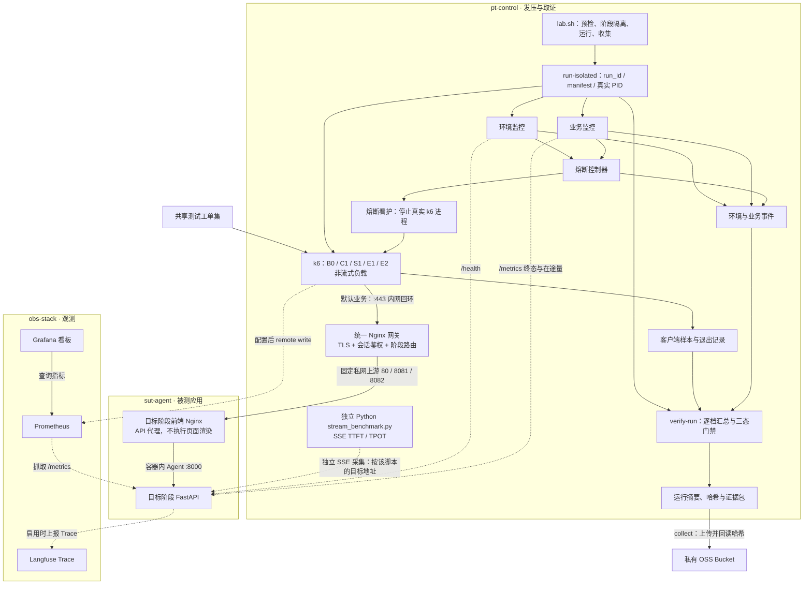

# 客服工单系统核心链路与架构（公开脱敏版）

> 公开脱敏版：由案例内部资料裁剪而来，已移除实例 ID、IP、账号、密钥与内部路径。

> 更新：2026-10-02，按专栏第 09 讲测试范围完成三层标注：图一蓝色圈注标业务终态出口与阶段一规划循环／工具执行，图二、图三按三档策略着色（绿＝真实压测、黄＝替身 Mock、紫＝只监控、灰＝范围外／施压与管理侧）。
> 更新：2026-10-01，按网关与业务调用代码、预压测第三轮原始摘要修正云上入口及阶段 1 Java 工具链路。

本页用四张 Mermaid 图说明三阶段被测应用的实际调用、阿里云部署和压测取证路径。图中的「阶段一／二／三」表示同一工单案例的三种实现；业务分支按工单内容选择，并非每笔工单都会查询订单、物流和知识库。

## 一、被测应用核心链路图

图中「人工处理建议」是当前可证明的出口，不表示系统已经创建人工工单或完成转交。阶段 1 当前云上订单、物流查询经 Java 服务读取 MySQL `order_logistics`，知识查询仍由 Agent 数据后端提供，云上为 MySQL `cs_agent`。本地直接启动的默认配置关闭 Java、读取 SQLite；本地根 Compose 同样开启 Java 并使用 MySQL。阶段 2 读取 SQLite 快照，阶段 3 从共享测试数据装载进程内数据并执行本地 RAG 检索。本地运行可直接进入前端代理；云上 k6 业务请求经统一网关与前端 Nginx，不运行页面渲染，路径见第 4 图。图内蓝色圈注为第 09 讲测试范围标注：一处在阶段一规划循环与工具执行（执行路径），一处在业务终态出口（业务路径）。

## 二、被测应用架构图

连线表示当前实现中的调用或观测关系，虚线表示共享能力或观测链路。根 Compose 对阶段 1 注入 `JAVA_SERVICE_ENABLED=true`，`AgentService` 据此注册 Java 订单、物流工具；2026-10-01 核实的 5 个窗口指纹也为 `java_service_enabled=true`。Java 使用 `order_logistics`，Agent 知识工具使用其数据后端，云上为 `cs_agent`，两者是不同数据库。阶段 2、3 的工具尚未接入该 Java 分支，不能把阶段 1 的取数链路推广到全部阶段。阶段 3 Workflow 在节点边界接入共享 Harness，不使用阶段 1 的规划循环。节点着色为第 09 讲三档策略：绿＝真实压测（接口、工具、共享执行、数据快照、链路内 Java）、黄＝替身（Mock Provider）、紫＝只监控（观测服务）、灰＝范围外／施压入口。

## 三、阿里云部署架构图

平时三阶段的 3 个 Agent 与 3 个前端可并行运行；标准编排测量窗暂停其他 2 个阶段，网关仅对非目标阶段前缀返回 503，目标阶段保持业务可测，窗口结束后恢复。替代运行器的隔离状态须按各窗口证据核对，不能由脚本设计推断实际已隔离。观测机 EIP 仅向管理网段开放 Langfuse 与 Grafana；被测机无公网业务入口。图中不包含尚未启用的压测平台、第三方故障桩或自研观测服务。节点着色为第 09 讲三档策略：绿＝真实压测（网关、前端代理、被测 Agent、链路内 Java 与 MySQL）、紫＝只监控（观测机三件套）、灰＝范围外／施压与管理侧。

## 四、压测架构图

k6 的云上默认业务路径为统一网关与阶段前端代理，客户端墙钟 E2E 包含这 2 跳；`BASE_URL` 仍用于控制面直连，不能凭 `manifest.target.base_url` 判断业务绕过网关。业务 URL、网关指纹与请求选择代码必须交叉核对；`GATEWAY=0` 显式直连对照须单独标注。k6 与网关同驻 `pt-control`，分机发压只证明 k6 与 Agent 进程分离，不能排除控制机资源竞争对网关的影响。

k6 记录完整响应、业务合格样本和运行级证据；环境监控还在发压机本地采样负载。`verify-run` 根据完整证据给出 `PASS`、`FAIL` 或 `NOT_VERIFIED`。Python 脚本单独测量 SSE 的 TTFT/TPOT，不从 k6 完整响应推算流式指标，也不表示它由 `run-isolated` 自动启动；服务端 `stream_mode=real` 配置标签同样不证明本轮 k6 发出了流式请求。

## 事实来源

- 三阶段共享 Harness 结构及各阶段 `src/` 实现。
- 阿里云部署方案、`<内部路径>` 与 `<内部路径>`。
- k6 共享套件及 `orchestrator/run-isolated.sh`。
- 业务请求选择、阶段路径拼接、统一网关配置、前端代理模板与阶段 1 工具注册。
- 统一网关链路核实与资料勘误：2026-10-01 原始摘要和业务 URL 的核对范围。