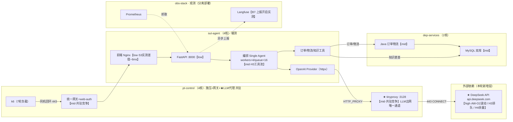

# S2 底稿：20261014-v12-real1 真实模型战役执行架构风险标记（RESAR 第二步）（公开脱敏版）

> 公开脱敏版：由案例内部资料裁剪而来，已移除实例 ID、IP、账号、密钥与内部路径。

> campaign：`20261014-v12-real1` ｜ 产出时间：2026-10-14 深夜 ｜ 上游输入：S1 底稿（AW-O1—O3、假设 H1—H7）+ 收窗交接单 + 部署事实（<内部路径> overlay）＋七轮 manifest 核验
>
> 口径：阶段 1 single-agent；**provider=openai（DeepSeek deepseek-flash）非流式**；SLO 20000ms；口径 B；数据档 v1.1 reference-balanced-uniform。**性质：新口径首建完整版映射（非复刻核对）**；全部风险标记为先验标记，不是实测结论（实测归 S4/S5）。

## 一、执行路径骨架（本轮实测核等，相对 Mock 轮的新增边标 ★）

被测路径（业务一笔请求）：k6(pt-control) →【同机回环 :443】统一网关 Nginx+web-auth（TLS/会话鉴权/阶段路由，pt-control）→ 前端 Nginx（sut-agent）→ FastAPI :8000（sut-agent 容器）→ 阶段编排 Single Agent → 分支：

- **★ LLM 出网边（本轮新增被测依赖）**：OpenAI 兼容 Provider（httpx）→ **容器 HTTP_PROXY=<IP>:3128 → pt-control tinyproxy → 公网 443 → api.deepseek.com**——被测路径**第二次穿越 pt-control**（进：网关；出：LLM 代理）；
- 工具分支：订单/物流 → Java 服务（dep-services）→ MySQL `order_logistics`；知识 → MySQL `cs_agent`；工具执行结果回到编排后再次进入 LLM 决策循环（一次决策可返回多个工具、逐一执行；S3 工具组间中位差 ≈+3—4s/级）。

观测自耗路径：Prometheus 抓取（obs→被测机）、业务/环境监控（pt-control→被测机）、**Langfuse exporter 异步上报（被测进程内→obs 机，本轮实测开启）**。施压自耗路径：k6/编排/证据采集全在 pt-control；**网关+web-auth+★tinyproxy 三者与 k6 共驻 pt-control**（4 核）。

**路径锁定证据**：七轮 manifest `provider=openai / model=deepseek-flash / 指纹 482ed0ffa2a09c17 / effective_limits（workers=4、queue=16、iter=10、max_tool_calls=5、timeout=30s）/ langfuse_enabled=true` 七轮逐轮一致（本地证据包 7/7 核对）；gateway_precheck_ok 七轮在位；/version 三要素实测（收窗交接单 DV-R1）。

## 二、AW→候选节点映射（本轮映射表＝先验风险标记）

风险口径：high=现象直接落在该节点且机制候选直接对应；mid=在被测路径且存在机制候选；low=在路径但现象不指向。承接 S1 假设编号。

### 2.1 映射表

| 窗/现象（S1 引用） | 候选节点（层） | 风险 | 依据与备注 |
|---|---|---|---|
| **AW-O1** b0 FX1000029（logistics）business_done=false 真实致歉，wall 17961 未超时，b0 计量期内唯一不合格；全场另有其他业务未完成记录 | LLM 生成内容层（provider 语义层） | **mid** | H5：模型偶发拒答候选；第五步亦未完成机制排除（2026-10-19 已撤回「非系统故障」判读，生成段 12.5s 未观测），继续待验证；S5 用同族正常/致歉工单三任务对照（Trace+Eval）定位 |
| **AW-O2** stab 桶 6（~13:00—13:05Z）P50/P99 抬升（6803/19325）后回落 | ★ DeepSeek API 时延波动（provider 传输+推理层，经 tinyproxy 出网） | **high** | H7：桶内 HTTP 错误率为 0、下桶回落；业务未完成另行核对——外部时延波动形态首候选；S4 用同期 pt-control/网关/tinyproxy 与容器指标做阴性排除（若本侧无同形波动则外部候选加强） |
| | pt-control 共驻竞争（k6+网关+★tinyproxy 同机，4 核） | **mid** | 20VU 持续下若控制机饱和会同步抬升差值段——S3 实测差值段 P50 ~6ms（桶 6 期未见放大）先验削弱「整机饱和」机制；★tinyproxy 代理自身等待位于服务端耗时内部（LLM 出网计入 e2e_server_ms），差值段测不到、不构成对它的削弱（2026-10-18 边界注），留 S4/S5 验证 |
| **AW-O3** c1 L1 工单 LD1000027，12:15:40.824Z，wall=16919ms、时延达标，流程与业务未完成 | Agent 执行／工具／生成及护栏路径（待定位） | 待评估 | 不能按小样本抖动排除；交 S5 用逐笔轨迹、终止原因与答复核对 |
| **H1/H3 时延主体与高档抬升**（L20—L50 P90 +13—20%） | ★ DeepSeek API 并发排队（provider 层） | **high** | H3 主候选：闭合模型下吞吐被单笔时延限制，高档位排队落在外部 API 或本地工具池；S3 双口径差值段稳态量级小（~6ms）按降级处理、不写排除（起跑/换档原因与直连对照待验——2026-10-25 勘正，原「已排除网关/前端段」系越级），S4 容器资源未见饱和后本候选加强 |
| | SUT 工具执行池（tool_workers=4 / queue=16） | **mid** | H3 次候选：>20VU 后工具池串行段显形（formal 系 DEGRADED-OBS 同型候选）；S4 层②（agent 容器 CPU/队列计数）+ S5 定向 |
| | FastAPI/uvicorn 并发容量（api） | **low** | S3 服务端耗时占比 ~100% 且形态随工具数分层——入口瓶颈会使全体族同步抬升，与观测不符，先验降低 |
| **H2 容量线性形态** | 被测路径全体节点 | **阴性预期** | Goodput 线性+P90 平坦 → 各节点均未见饱和拐点；S4 四层同期做资源侧复核 |
| **H4 e1 突刺吸收** | ★ DeepSeek API 并发余量 | **mid** | spike 相位 76/76 合格、P90 不升——外部余量充足候选；S4 同期对照复认 |
| **H6 token/成本平稳** | LLM 上下文缓存（provider 计费层） | **观测项** | 3617 token/笔平稳、有效单价 ¥1.21/M（缓存命中）；无架构风险，S3 成本分解消费 |

### 2.2 风险标记架构图

## 三、施压自耗与共驻登记（B7 口径）

| # | 核查项 | 结论 | 证据 |
|---|---|---|---|
| 1 | 观测栈与被测分离部署 | 通过 | manifest nodes 段七轮：Langfuse/Prom/Grafana 在 obs-stack；被测在 sut-agent |
| 2 | Langfuse 上报状态 | **开启（实测）** | manifest `observation.langfuse_enabled=true` 七轮；观测层读数按 B7 受染范围限定标注（S3/S4 消费时继承） |
| 3 | 施压自耗不在被测路径 | **部分通过（范围较 Mock 轮收窄后复扩）** | k6 与 Agent 分机成立；但网关+web-auth+**★tinyproxy** 与 k6 共驻 pt-control，被测路径两穿越控制机——资源竞争未排除（★tinyproxy 为本轮新增暴露：全部 LLM 流量经控制机转发）；S4 层④正查 pt-control loadavg/容器指标 + tinyproxy 连接态 |

**B7 verdict：contaminated（范围限定）**——观测分离通过、上报开启受染标注、共驻暴露较 Mock 轮新增 tinyproxy 边；不整轮作废。

## 四、运行窗部署变更核对

- 七轮 manifest 一致段（provider/model/指纹/limits/langfuse/数据档两池哈希）**逐轮零漂移**（本地证据包 7/7 核对，§一）。
- 窗前已披露事件（收窗交接单登记，非窗内变更）：①sync-agent 切换 openai（12:32Z 前后）；②`.env` PERF_*/MOCK_RULE_VERSION 三行补回；③`.env` LAB_SLO_MS 20000 与 k6-suite 七文件推送（口径 B，12:5xZ 前）。执行窗（12:00—13:10Z）内无 rebuild/switch-data 事件；每轮 do_run 的 deploy-role 为幂等重建检查（配置未变不重建）。
- `deploy_change_in_window = false`（证据强度：manifest 逐轮一致 + 指纹单值 482ed0ff 七轮 + run 日志无部署事件）。

## 五、S1 移交疑点审查（结构性事实确认，非性能结论）

- **c1 档界排水量级**（继承 formal §6.1 机制，本轮单笔时延 6—7s）：旧档在途排水窗按单笔时延估算 ~6—8s，stabilization 60s 覆盖充分，**measured 窗并发=名义档位结论继承成立**；stab（constant-vus 无档界）不涉及。
- **e1 计量窗 gauge 语义**（继承 formal §6.2）：相位型场景计量窗起点=首相位末笔发射时刻，e1 官方窗口径读数代表窗内相位子集——S1 已按相位分列（§3.3），两口径并存不混比。

## 六、交接

- **candidates_for_s3s4（S3 已消费/待 S4 消费排序）**：①★DeepSeek API 层（AW-O2 桶 6 波动、H3 高档排队、H4 突刺余量）——S4 用 pt-control/网关/tinyproxy/容器同期指标做阴性排除与形态对齐；②SUT 工具池（H3 次候选）——S4 层② agent 容器 CPU+队列计数正查；③pt-control 共驻（网关+★tinyproxy）——S4 层④ loadavg+容器 CPU 七窗时点对照；④Java/MySQL（dep 机 2 核）——S4 层③ JVM/MySQL 指标在 L30/L50 与桶 6 窗对照；⑤AW-O1 致歉——S5 三任务对照（同族 logistics 正常笔 vs 致歉笔 Trace+Eval）；⑥AW-O3 业务未完成——LD1000027 时延达标，但执行／工具／生成路径待 S5 Trace/Eval 与终止原因核对。
- **unknowns**：U1 差值段内子段（k6/回环/网关/前端）不可分——S3 实测全场 ~6ms、量级上不可分不再必要（降级为登记项）；U2 tinyproxy 无专用指标序列（连接数/吞吐未采集）——S4 以 pt-control 容器/主机侧指标代理判读，登记覆盖缺口；U3 DeepSeek 侧服务指标不可得（外部黑盒）——外部候选判定采用「本侧阴性排除法」。
- **confidence = 0.85**。加分：七轮 manifest 零漂移核验、S3 恒等式差值段稳态降级（映射表有实测约束；起跑/换档与直连对照待验——2026-10-25 勘正）；扣分：tinyproxy 无直接序列（U2）、外部黑盒（U3）、AW-O1 单笔样本。
- **停止声明**：映射表与风险图成稿即停；未做 S4 实测下钻、未下瓶颈结论（S6 职责）；风险标记全部先验。